# UMEX Drone Challenge: Technical Mentorship

**Role:** Technical Mentor (project-based), UMEX Drone Challenge, Abu Dhabi
**Period:** November 2025 to January 2026
**Platform:** Hula drone, Python, ONNX Runtime

I mentored university students and graduate engineers who programmed Hula drones to complete two autonomous missions: solving an unknown maze and finding objects inside it. This repository documents that work. It contains the two challenges, the reference solutions I used to teach them, the maze algorithms (DFS, BFS and A*), the ONNX object detector, photos and videos from the workshop sessions, and feedback from the participants.

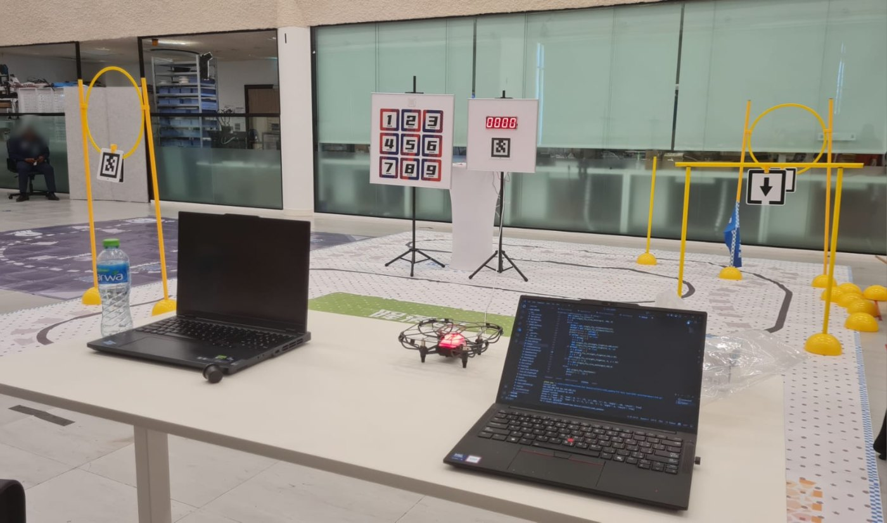

## Contents

1. [Mentorship summary](#mentorship-summary)
2. [Results and participant feedback](#results-and-participant-feedback)
3. [The two challenges](#the-two-challenges)
4. [The Hula drone and its sensors](#the-hula-drone-and-its-sensors)
5. [System diagram](#system-diagram)
6. [Maze algorithms: DFS, BFS and A*](#maze-algorithms-dfs-bfs-and-a)
7. [Object detection with the ONNX model](#object-detection-with-the-onnx-model)
8. [Code walkthrough](#code-walkthrough)
9. [Run it](#run-it)
10. [Workshop photos and videos](#workshop-photos-and-videos)
11. [Repository structure](#repository-structure)
12. [Credits and notes](#credits-and-notes)

## Mentorship summary

| | |
|---|---|
| Role | Technical Mentor (project-based) |
| Programme | UMEX Drone Challenge, hosted by EDGE and the UAE Ministry of Defense |
| Location | Abu Dhabi, UAE |
| Period | November 2025 to January 2026 |
| Mentees | University students and graduate engineers, working in teams |
| Stack | Python, pyhula drone SDK, Tkinter, OpenCV, ONNX Runtime |

**What I did**

- Guided teams through the design and implementation of drone systems for competitive missions.
- Taught Hula drone flight dynamics, autonomous navigation and maze-solving algorithms in Python.
- Supported AI-based perception: how the ONNX object detection model runs on the drone camera stream during a mission.
- Helped teams debug flight code, sensor readings and the detection pipeline.
- Prepared reference solutions for both challenges to explain each step in the workshop sessions.

**Skills this work demonstrates**

| Skill | Where to see it |
|---|---|
| Technical mentoring and training | Workshop photos and videos, participant feedback |
| Autonomous navigation | `challenge_1_maze_navigation.py` |
| Graph search (DFS, BFS, A*) | [Maze algorithms](#maze-algorithms-dfs-bfs-and-a), `simulation/maze_solvers.py` |
| Computer vision and model deployment | `onnxdetector.py`, [ONNX section](#object-detection-with-the-onnx-model) |
| Operator interface design | Tkinter GUI in `challenge_2_object_detection_mission.py` |
| Sensor use (proximity, QR positioning) | [Drone and sensors](#the-hula-drone-and-its-sensors) |
| Debugging under time pressure | Code freeze rules, crash and restart handling |

## Results and participant feedback

Participants from the teams I worked with posted about their results after the event:

- One team placed **3rd overall** in the MoD Drone Challenge at UMEX 2026. It ranked **2nd of 28 teams** in Challenge 1 and **3rd of 17 teams** in Challenge 2, after 17 teams advanced to it.
- Another participant reported that his team took **2nd place** in the Drone Challenge. His team programmed a drone to explore a maze on its own, race to several goals and detect objects.

These results belong to the participants and their teams. I supported them as a mentor.

What participants wrote to me (names removed):

> "Your guidance and mentorship played a huge part in our performance." (Senior associate researcher)

> "Your guidance and support throughout the journey meant a lot to us and truly made a difference." (MSc student in computer vision)

> "Your guidance, patience and constant support made a huge difference for us throughout the challenge." (Computational systems student)

> "We truly couldn't have done it without you." (Participant, message sent after the challenge)

A principal software engineer who finished 2nd thanked me in a public post for the training and guidance I gave during the whole challenge.

<details>
<summary>All feedback screenshots (names and profile photos blurred)</summary>

<br>

| | |
|---|---|
| 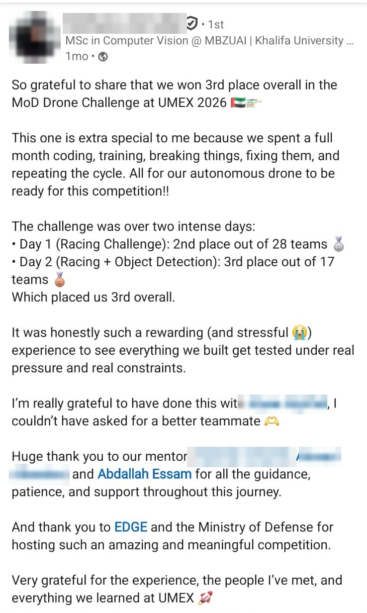 | 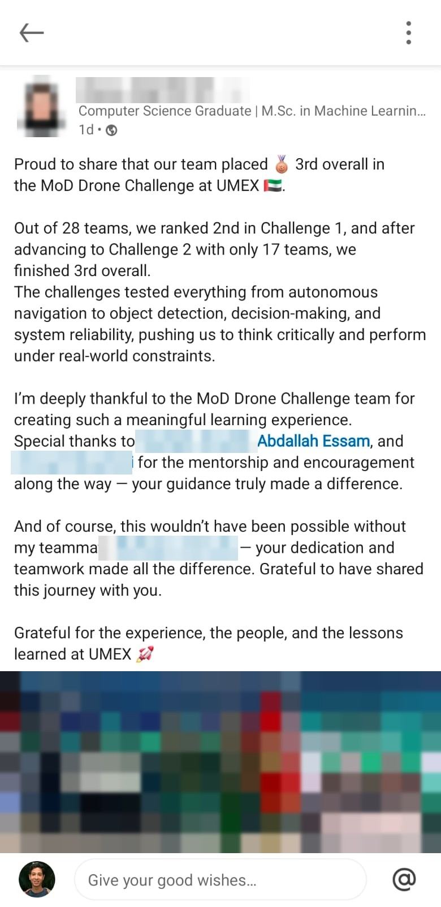 |
| 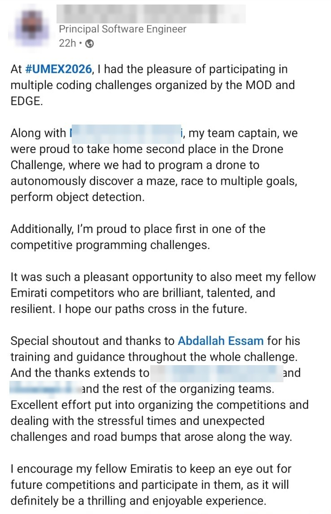 |  |
| 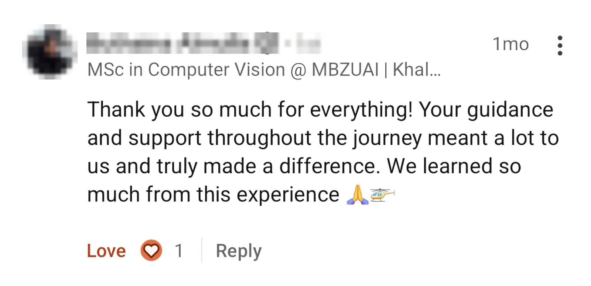 | 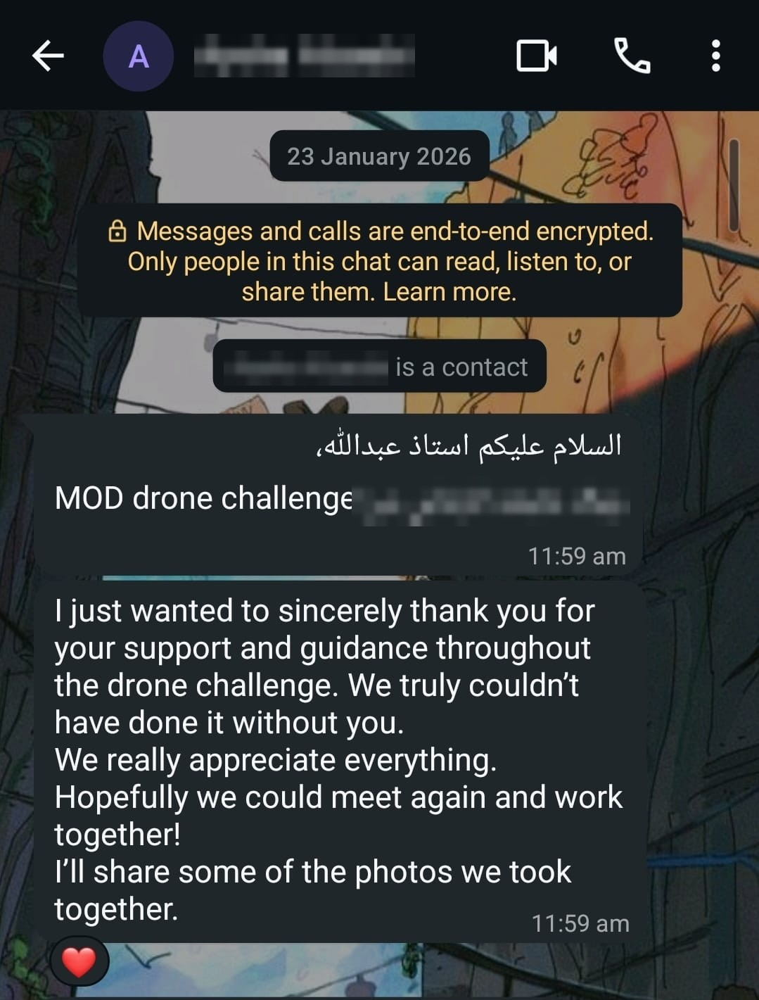 |
| 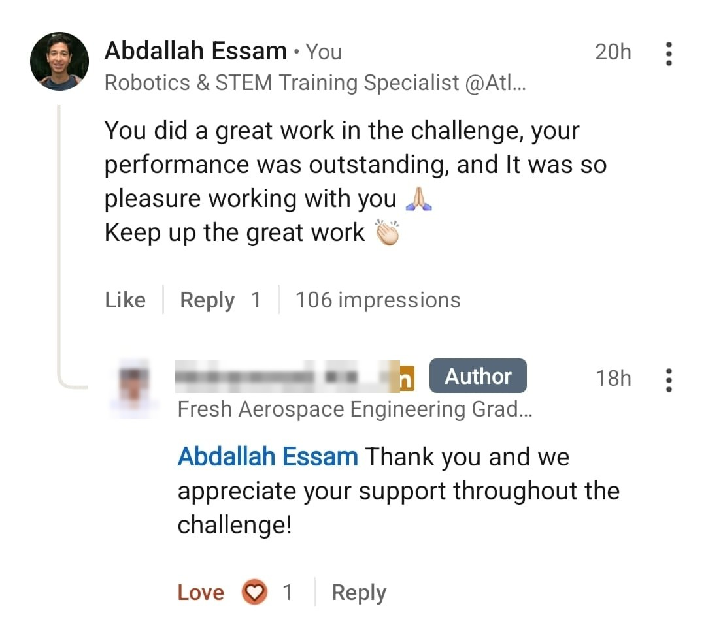 | 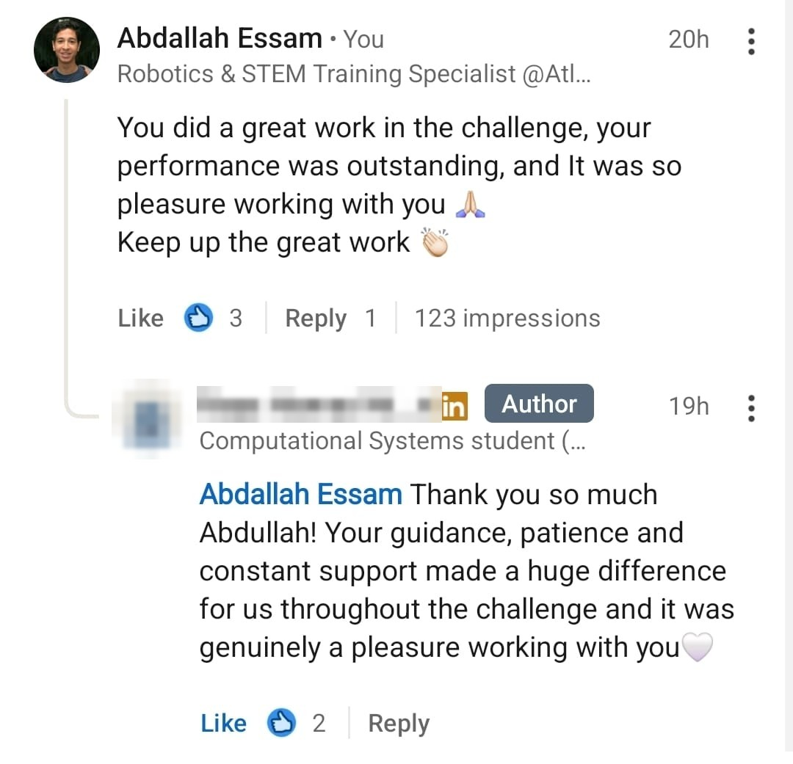 |
|  | 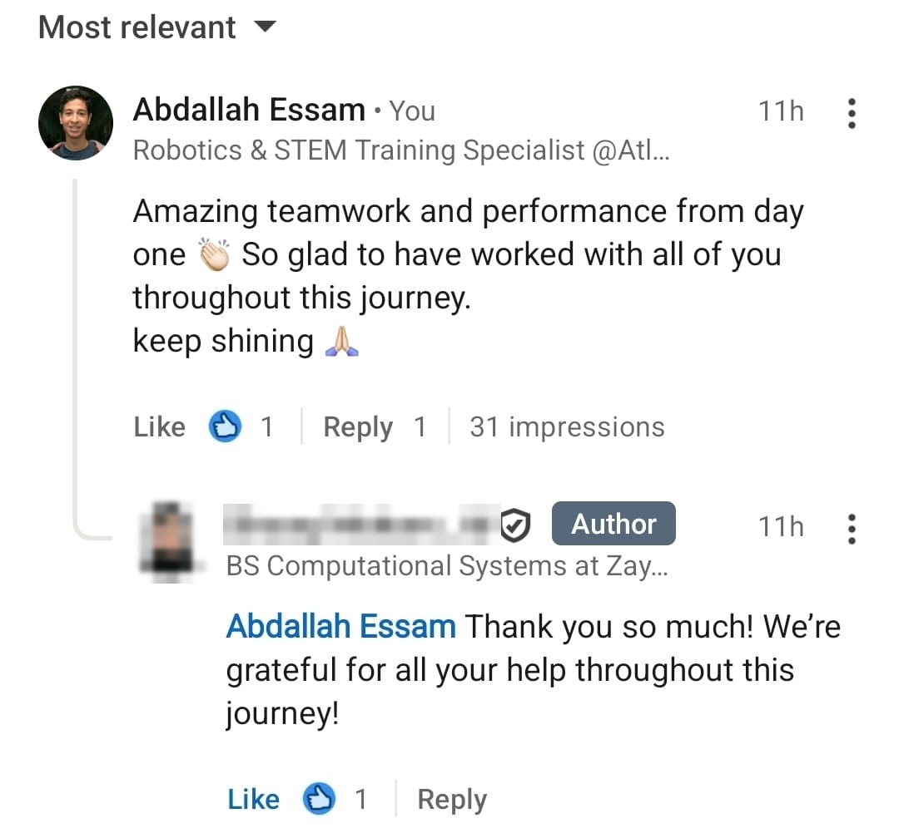 |

</details>

## The two challenges

### Challenge 1: Navigate the maze

The drone starts in a known cell of an n x n maze and must reach a known target cell. The inner walls are unknown to the teams.

| Item | Rule |
|---|---|
| Sensing | Detect walls with the proximity sensors and navigate with the QR code carpet |
| Discovery phase | 10 minutes, no scoring. The code can fly the maze freely and remember the wall layout. |
| Racing phase | 10 minutes. The timer starts at takeoff and stops when the drone lands in the target cell. Teams can restart from the start cell as often as they like. |
| Score | Time from start to finish first, then points for each correct square passed |
| Code freeze | Code was submitted the evening before the first day of UMEX, with no changes allowed during the event |

### Challenge 2: Object detection in the maze

Teams build a graphical interface (the Command and Intelligence Interface, CxI) that controls the drone and finds objects inside the maze.

| Item | Rule |
|---|---|
| Inputs | Maze size, start cell, start bearing and object cells, all typed into the GUI. Hardcoding is forbidden. |
| Discovery phase | 15 minutes, no scoring |
| Race phase | 15 minutes. Start with a "Start Mission" button, then detect and identify every object. |
| Display | The GUI shows the detected objects, a snapshot of each one and where it was found |
| Validation | Each detection triggers a snapshot that the judges check |
| Crashes | The drone restarts from the crash location, validated objects stay counted and the clock keeps running |
| Score | Number of correct objects first, then time |
| Model | The organizer-provided AI model must be used as it is, with no retraining or replacement |

The original challenge documents belong to the organizers, so I summarized the rules here instead of copying them.

## The Hula drone and its sensors

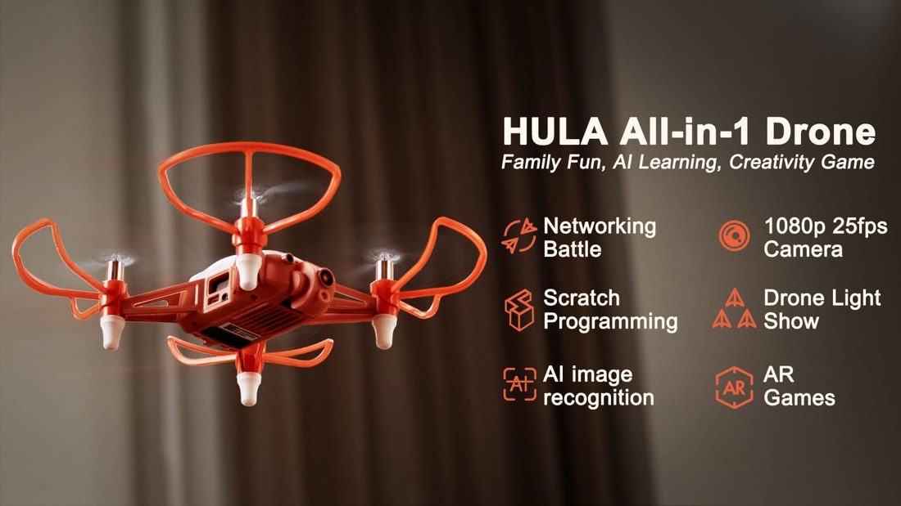

The Hula is a small educational drone with a protective frame. It has a 1080p camera, supports Scratch and Python programming, and runs AI image recognition. The challenges used it through the Python SDK (`pyhula`).

| Sensor | What it does in these missions | SDK call used |
|---|---|---|
| Proximity sensors | Report a wall in front of, behind, left of and right of the drone. This builds the maze map. | `Plane_getBarrier()` returns `forward`, `back`, `left`, `right` |
| QR positioning | The drone reads QR tags on the carpet and reports its x, y and z position in centimeters. The code uses it to center the drone in each 60 cm cell. | `get_coordinate()`, `Plane_cmd_switch_QR()` |
| IMU | Measures orientation and acceleration. The flight controller uses it to hold attitude and heading. The reference code does not read it directly. | Used inside the flight commands |
| Camera | Streams H.264 video over RTP to the laptop, where the detector reads frames | `hula_video.py` (ffmpeg decoding) |

Flight commands used: `single_fly_takeoff`, `single_fly_forward`, `single_fly_back`, `single_fly_left`, `single_fly_right`, `single_fly_turnleft`, `single_fly_turnright`, `single_fly_straight_flight` and `single_fly_touchdown`.

## System diagram

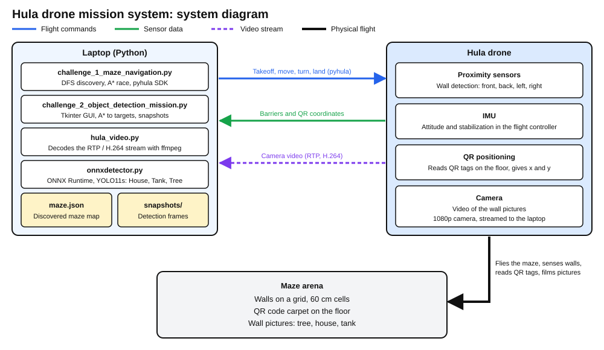

The laptop runs all the logic. It sends flight commands through the SDK and receives sensor data and the video stream. The drone flies a maze built from walls on a grid, with a QR code carpet on the floor and pictures on the walls.

### Challenge 1 flow

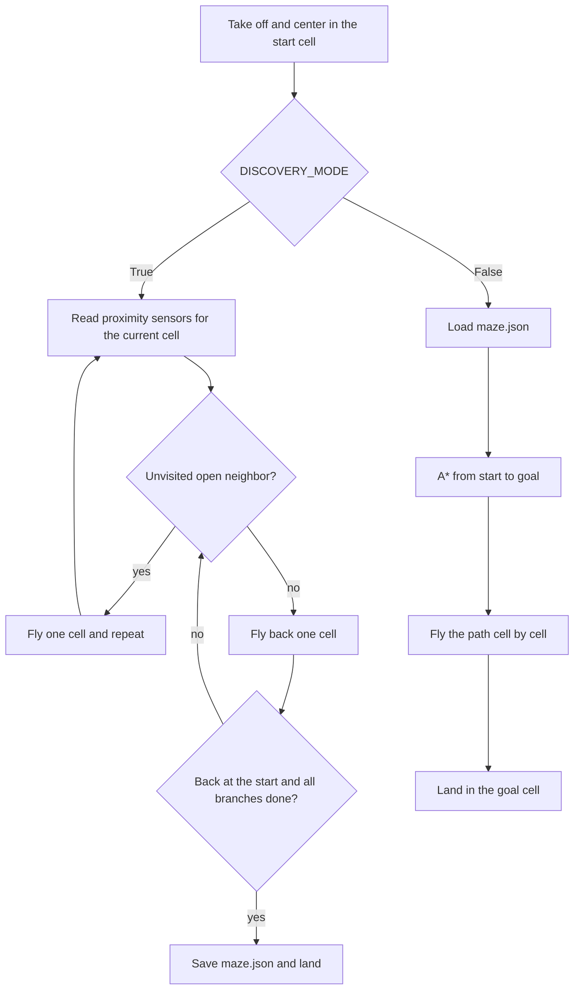

### Challenge 2 flow

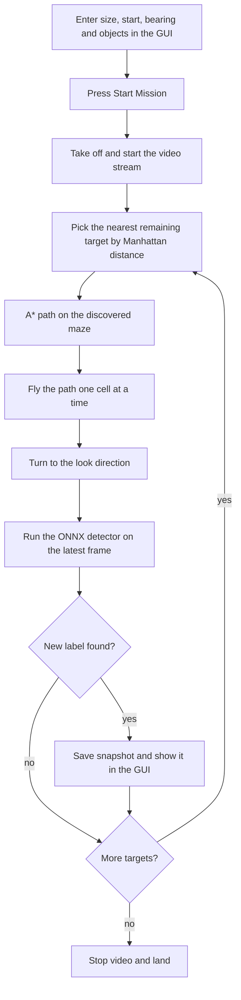

## Maze algorithms: DFS, BFS and A*

### How the maze is stored

Every cell keeps four booleans, one per side, where `True` means a wall. The discovery run writes them to `maze.json`:

```json
{
  "width": 6,
  "height": 6,
  "cells": {
    "2,0": {"N": false, "E": false, "S": true, "W": false},
    "2,1": {"N": false, "E": false, "S": false, "W": true}
  }
}
```

The x axis points east and the y axis points north. The drone always keeps its heading (camera facing north) and strafes sideways instead of turning, so one move is always one 60 cm step in a fixed direction.

### DFS: discovery phase (used in `challenge_1_maze_navigation.py`)

Depth-first search fits discovery because the drone senses only the cell it stands in.

1. Read the four proximity sensors and record the walls of the current cell.
2. Look at the open sides in the order N, E, S, W. Fly into the first neighbor not yet visited.
3. Repeat from the new cell.
4. At a dead end, fly back one cell (physical backtracking) and try the next open side.
5. When every branch is done, save the map.

The drone visits each cell once and flies each connection twice, once forward and once back. On the 34 cells in the sample `maze.json`, that is 66 one-cell moves.

### BFS: shortest path on a known map (not flown, used for teaching)

Breadth-first search visits all cells at distance 1 from the start, then all cells at distance 2, and so on. On a grid where every move costs the same, the first time it reaches the goal it has found a shortest path.

BFS needs to jump between frontier cells. A drone cannot do that, so BFS does not suit discovery. It works well for planning on a finished map. I used it in the workshop as the baseline that A* improves on, and `simulation/maze_solvers.py` runs it on the same maze.

### A*: racing phase and Challenge 2 (used in both challenge files)

A* ranks cells by `f = g + h`, where `g` is the number of moves from the start and `h` is the Manhattan distance to the goal.

```python
def manhattan(a, b):
    return abs(a[0] - b[0]) + abs(a[1] - b[1])

# inside astar(): push neighbors with priority cost + heuristic
heappush(open_set, (cost + manhattan(neighbor, goal), neighbor))
```

On a grid with four-direction moves, Manhattan distance never overestimates the real distance, so A* still returns a shortest path while it expands fewer cells than BFS.

### Comparison on the real maze

I ran all three on the 6 x 6 maze the drone discovered (`maze.json`), from cell (2, 0) to cell (0, 5):

| Algorithm | Role | Path length | Cells expanded | Shortest path |
|---|---|---|---|---|
| DFS | Discovery by the drone (flown) | 11 moves | 34 | Yes |
| BFS | Planning baseline (not flown) | 11 moves | 30 | Yes |
| A* | Racing and Challenge 2 (flown) | 11 moves | 18 | Yes |

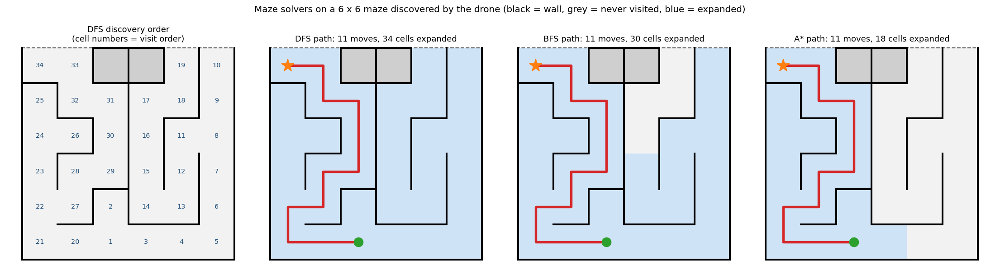

All three return a path of 11 moves because this maze has no loops. Only one route connects any two cells, so every algorithm finds it. The difference is the work done: A* expands 18 cells, BFS 30 and DFS 34. In a maze with loops, DFS can return a longer path, while BFS and A* still return a shortest one.

## Object detection with the ONNX model

The organizers supplied the model. Teams had to use it as it is. I explained how it works and how to run it on the drone camera.

| Property | Value |
|---|---|
| File | `detect_3_object_12_11.onnx` (about 38 MB) |
| Model | Ultralytics YOLO11s, object detection task |
| Classes | `House`, `Tank`, `Tree` (listed in `object.txt`) |
| Input | `images`, shape `1 x 3 x 640 x 640`, float32, RGB, values scaled to 0 to 1 |
| Output | `output0`, shape `1 x 7 x 8400`: 4 box values and 3 class scores for each of 8400 candidate boxes |
| Export | Ultralytics 8.3.227, ONNX opset 9, no built-in NMS |
| Runtime | ONNX Runtime on the CPU |
| License | AGPL-3.0 (stated in the model metadata) |

**Pipeline in `onnxdetector.py`**

1. Convert the video frame from BGR to RGB and resize it to 640 x 640.
2. Divide by 255 and reorder to channels first.
3. Run the ONNX session.
4. Transpose the output to 8400 rows, take the best class score for each row and drop rows below the confidence threshold (0.3 in the mission code).
5. Convert box centers and sizes back to the original frame size.
6. Run non-maximum suppression with an IoU threshold of 0.2.
7. Draw the boxes and return the highest-scoring detection.

**In the mission** (`challenge_2_object_detection_mission.py`), the drone arrives at a target cell, turns to the look direction from the GUI and runs the detector on the latest video frame. If the label is new, the code saves the annotated frame as `snapshots/<x>_<y>_<label>.jpg` and shows it in the GUI list.

Two snapshots from the drone are in `snapshots/`:

| `3_0_Tank.jpg` (cell 3, 0) | `3_3_House.jpg` (cell 3, 3) |
|---|---|
| 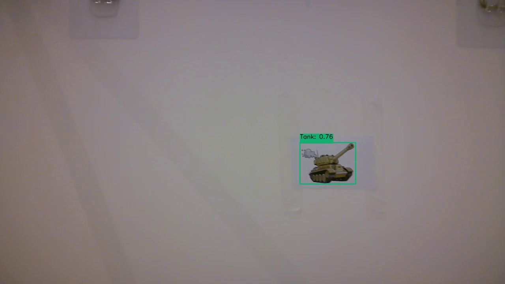 | 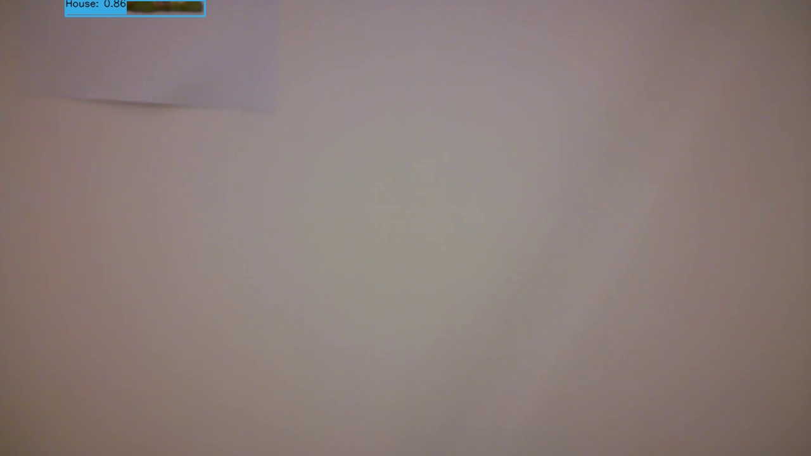 |

The tank scored 0.75. The house was detected with a score of 0.78 although only the top edge of the picture was in the frame, which shows that the detector tolerates partial views. The cell label in the file name is the cell where the drone took the picture.

## Code walkthrough

| File | Purpose |
|---|---|
| `challenge_1_maze_navigation.py` | Challenge 1. DFS discovery with physical backtracking, then A* racing from a saved `maze.json`. Switch phases with `DISCOVERY_MODE`. |
| `challenge_2_object_detection_mission.py` | Challenge 2. Tkinter GUI, A* path planning on the saved maze, strafing movement, turning to look directions, ONNX detection and snapshots. |
| `challenge_2_prototype_open_grid.py` | Earlier prototype of the Challenge 2 mission. It takes the maze size from the GUI and plans on an open grid without wall data. |
| `hula_video.py` | Helper that receives the drone video stream and decodes it with ffmpeg (workshop-provided) |
| `onnxdetector.py` | Helper that runs the ONNX model and draws detections (workshop-provided) |
| `simulation/maze_solvers.py` | Offline DFS, BFS and A* comparison on `maze.json`, with a figure |
| `maze.json` | A maze map discovered by the drone |
| `object.txt` | Class labels for the detector |
| `tmp.sdp` | SDP description of the H.264 RTP video stream |
| `snapshots/` | Detection frames saved during a mission |

Settings to change in `challenge_1_maze_navigation.py`: `MAZE_WIDTH`, `MAZE_HEIGHT`, `START`, `GOAL`, `CELL_DISTANCE` (60 cm) and `DISCOVERY_MODE`.

## Run it

**Without a drone** (maze algorithms and the detector):

```bash
pip install -r requirements.txt

# DFS, BFS and A* on the discovered maze, with a figure
python simulation/maze_solvers.py --maze maze.json --start 2,0 --goal 0,5 --plot docs/images/maze_solvers.png
```

**With a Hula drone**: the `pyhula` SDK, `ffmpeg-lib.dll` and the drone are provided by the workshop environment. Run the commands from the repository root, because the code opens `maze.json`, `object.txt` and the ONNX model by relative path.

```bash
# Challenge 1: set DISCOVERY_MODE = True, fly, then set it to False and fly again
python challenge_1_maze_navigation.py

# Challenge 2: enter the inputs in the GUI and press Start Mission
python challenge_2_object_detection_mission.py
```

## Workshop photos and videos

**Workshop sessions**

| | |
|---|---|
| 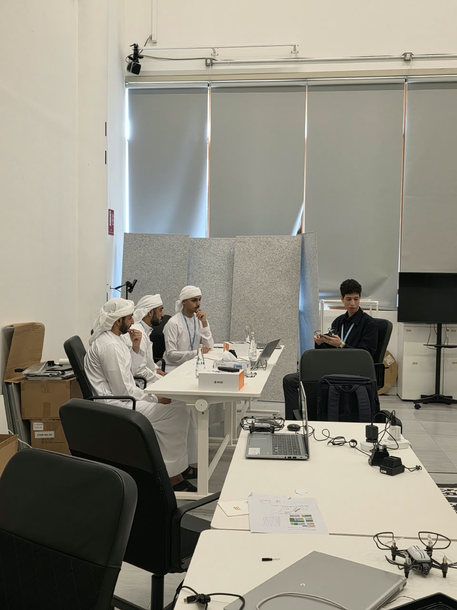 | 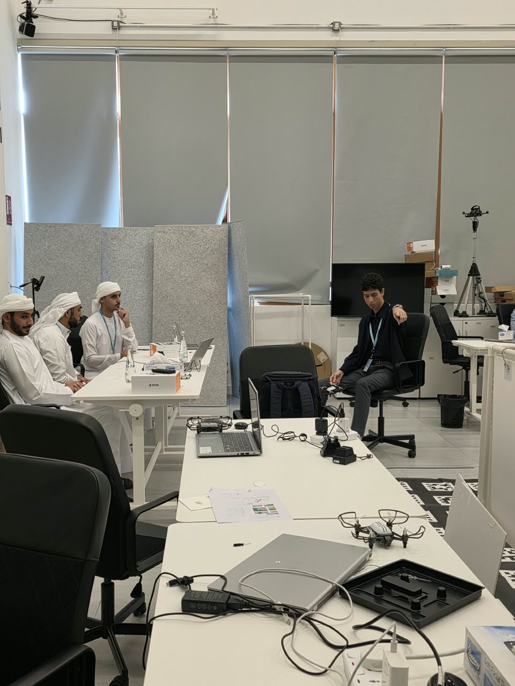 |
| 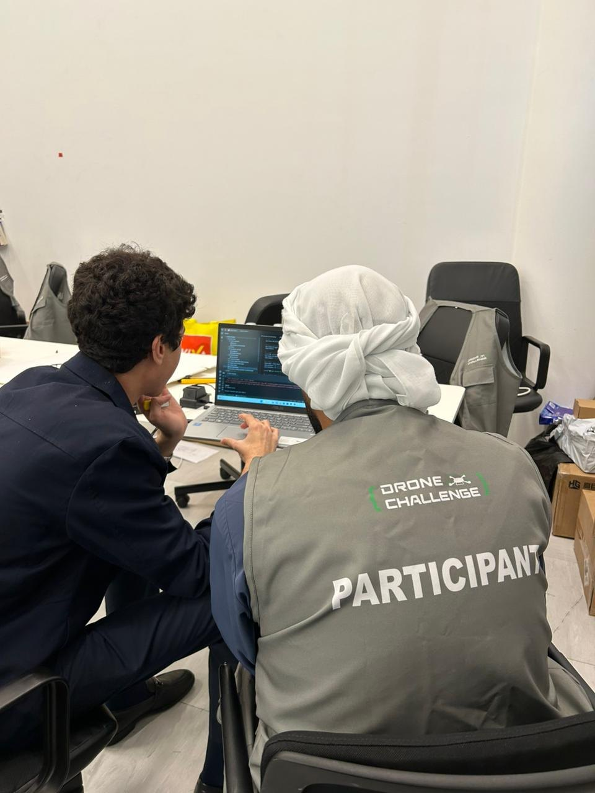 | 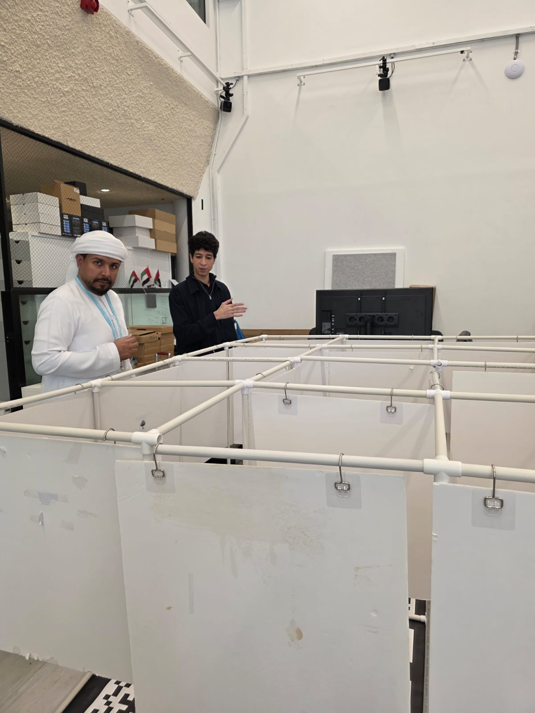 |

**Live demonstrations** (faces of participants and spectators are blurred)

| Maze solving with the Hula drone | Workshop session on the test course |
|---|---|
| 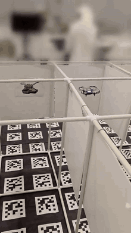 | 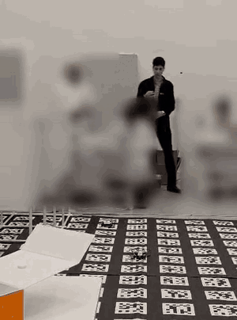 |
| [Full video](docs/videos/maze-solving-demo.mp4) | [Full video](docs/videos/workshop-demo.mp4) |

**The competition at UMEX, Abu Dhabi**

| | |
|---|---|
| 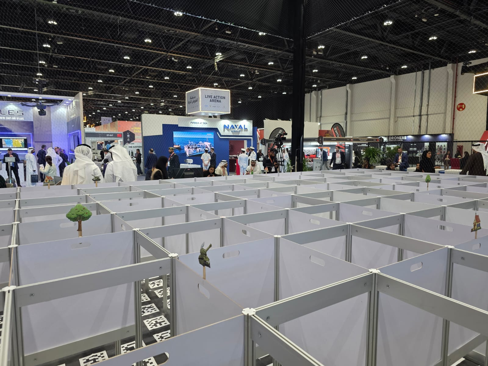 | 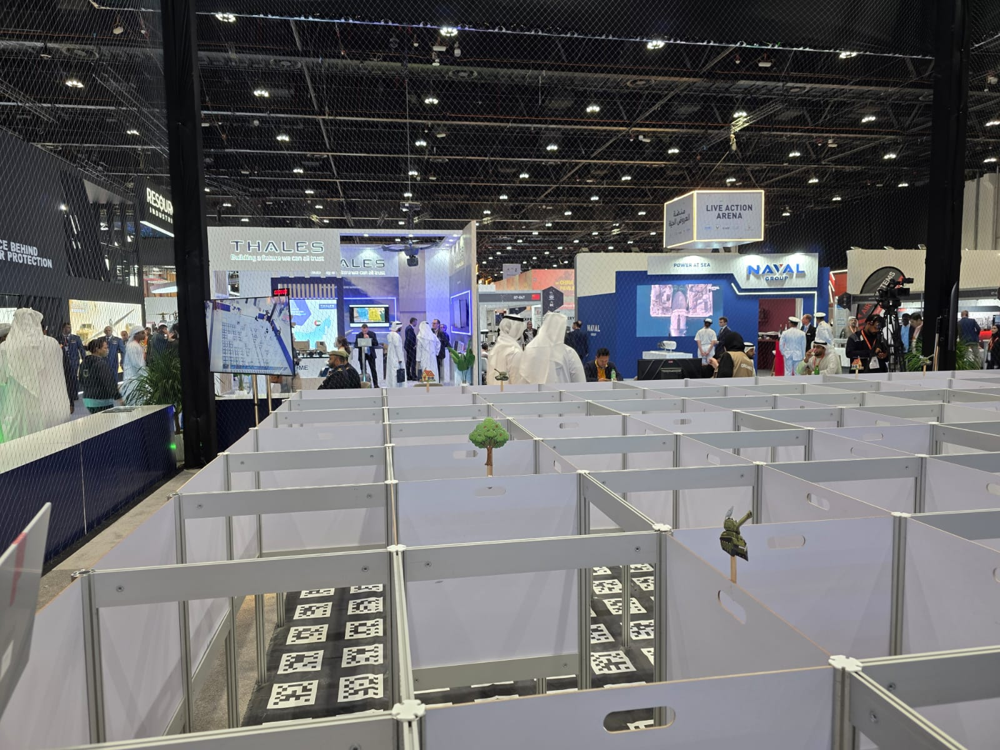 |
| 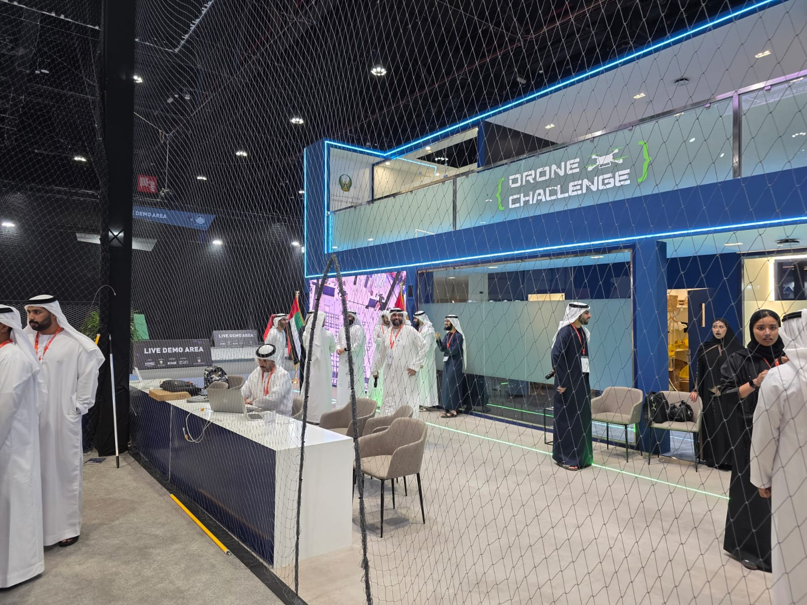 | 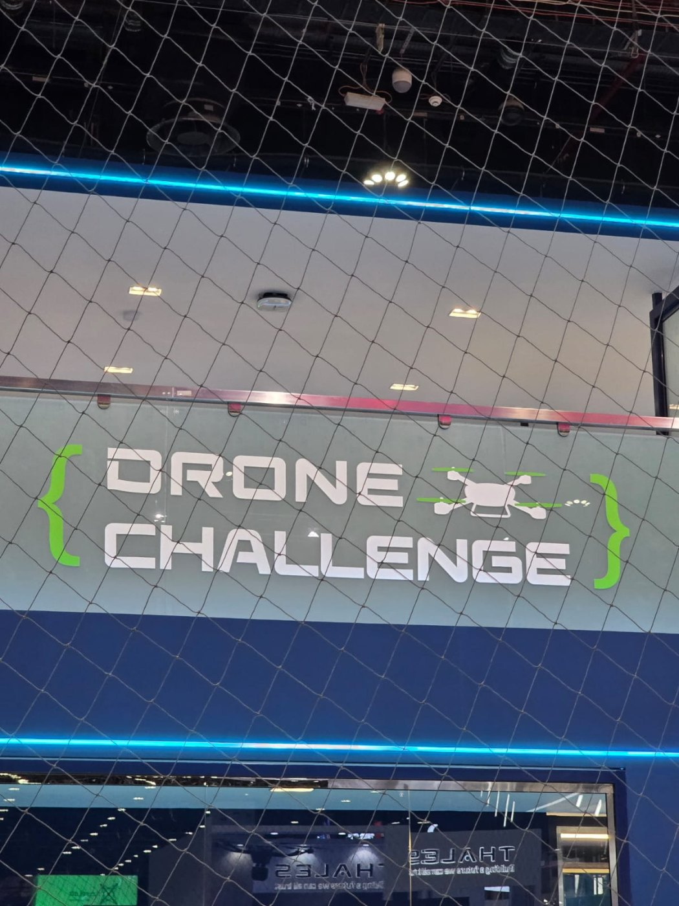 |
| 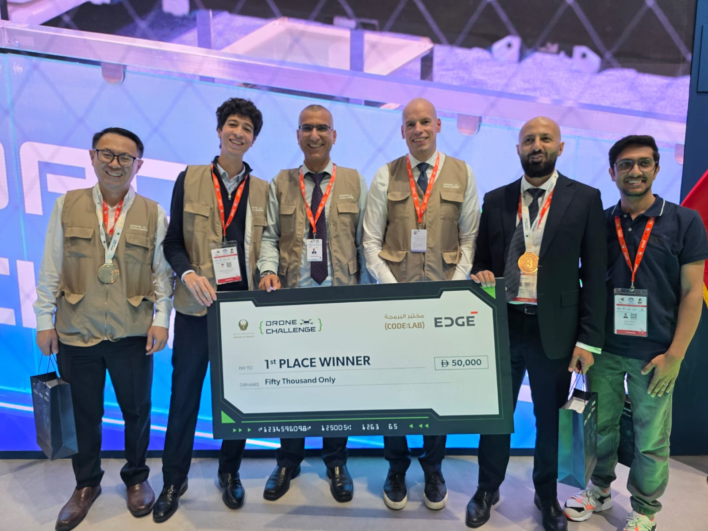 | 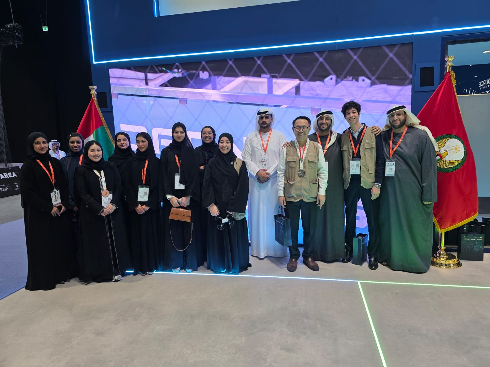 |

## Repository structure

```
umex-drone-challenge-mentorship/
├── README.md
├── requirements.txt
├── .gitignore
├── challenge_1_maze_navigation.py
├── challenge_2_object_detection_mission.py
├── challenge_2_prototype_open_grid.py
├── hula_video.py
├── onnxdetector.py
├── detect_3_object_12_11.onnx
├── object.txt
├── maze.json
├── tmp.sdp
├── snapshots/
│   ├── 3_0_Tank.jpg
│   └── 3_3_House.jpg
├── simulation/
│   └── maze_solvers.py
└── docs/
    ├── system_diagram.svg
    ├── images/
    └── videos/
```

## Credits and notes

- The UMEX Drone Challenge is organized by EDGE and the UAE Ministry of Defense. The challenge rules summarized above come from their documents.
- The ONNX model, `hula_video.py` and `onnxdetector.py` were provided during the workshop. The model is an Ultralytics YOLO11 export under AGPL-3.0, and the detector helper appears to be adapted from the Ultralytics ONNX example. The `pyhula` SDK and `ffmpeg-lib.dll` belong to the drone vendor and are not in this repository.
- The Hula product image is from the manufacturer's material.
- Faces of participants and officials are blurred in the photos and videos, and names and profile pictures are blurred in the feedback screenshots.
- No license file is included yet. Choose one after checking the terms of the third-party parts listed above.
